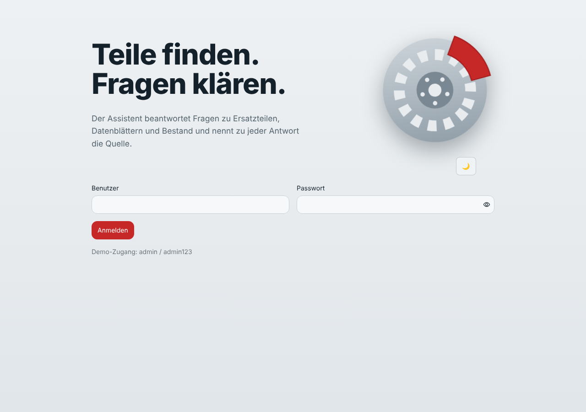
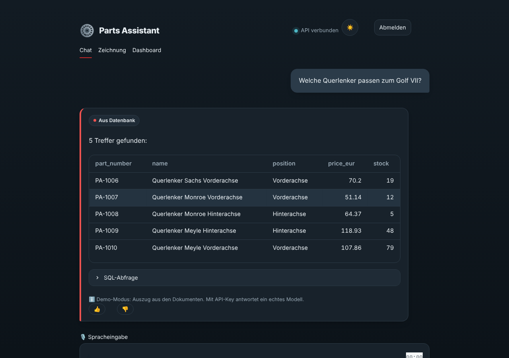
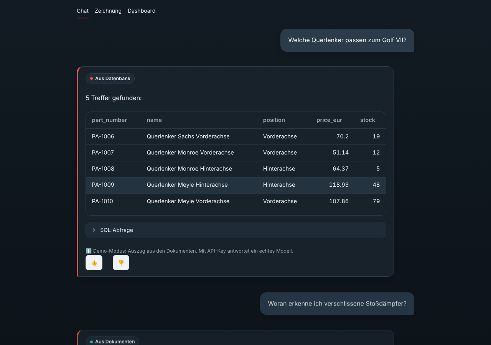
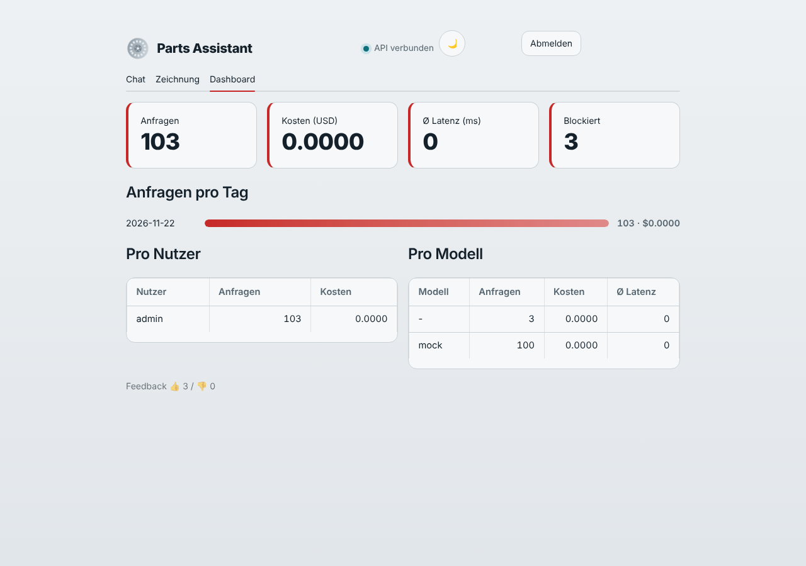
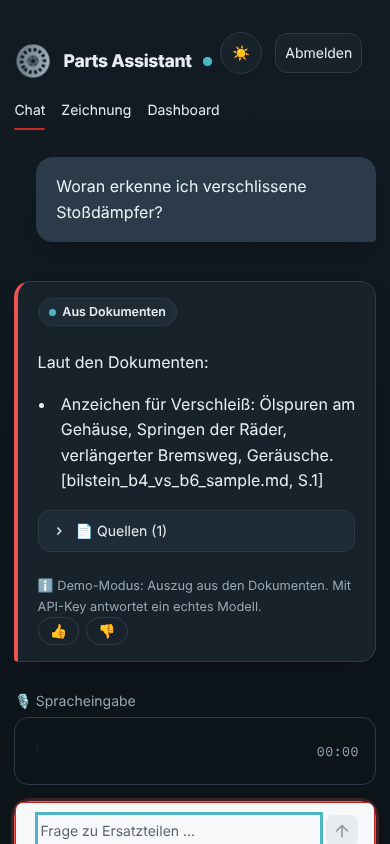

# 🔧 Parts Assistant: RAG chatbot for automotive aftermarket data

An internal-style AI assistant that answers questions about spare parts and technical documents, built as a portfolio project.
Built with FastAPI, Chroma, Streamlit and an LLM API. Parts of the code were written with AI coding tools .

> ⚠️ **Status:** the sample documents in `data/docs` and the parts DB are **synthetic**. Replace them with real public datasheets
> (see `data/README.md`). Without API keys the app runs in **mock mode**; benchmark numbers are only meaningful with real keys.

## Screenshots
| Login (light / dark) | Chat with database answer (dark) | Loading state |
|---|---|---|
|  |  |  |

| Dashboard (light) | Mobile (dark) |
|---|---|
|  |  |

**UI notes:** light/dark toggle (persisted in the URL as `?theme=dark`), responsive from phone to desktop, themed tables and charts (no canvas widgets), streamed answers, loading skeleton, `prefers-reduced-motion` respected, WCAG AA contrast in both themes. Styling: `ui/style.css`, `.streamlit/config.toml`.

## Features
| Area | What it does | Where |
|---|---|---|
| RAG | Chunking (heading-aware or fixed window), embeddings, Chroma, cited answers, "I don't know" | `app/ingest.py`, `app/rag.py` |
| SQL "chat with your data" | Text-to-SQL on a mock ERP; read-only connection, allow-listed tables, validator | `app/rag.py`, `app/security.py` |
| Router | Sends questions to RAG or SQL | `app/rag.py: route` |
| REST API | `/chat /feedback /usage /upload-drawing /transcribe /login` (docs at `/docs`) | `app/main.py` |
| Cost & usage | Tokens, latency, cost per request, per user/day/model dashboard | `/usage`, Dashboard tab |
| Security | JWT login, rate limit, PII redaction, injection heuristics (direct + indirect), SQL validator | `app/security.py`, `eval/security_tests.py` |
| Model benchmark | 30 questions (DE/EN, lookup/compare/SQL/unanswerable/injection) | `eval/run_benchmark.py` |
| Vision | Drawing/photo → JSON (part type, dimensions, part numbers) → DB match | `app/vision.py` |
| Voice | Whisper API or local faster-whisper | `app/voice.py` |
| Feedback | 👍/👎 stored in DB | UI + `/feedback` |

## Quickstart
```bash
cp .env.example .env            # add ANTHROPIC_API_KEY / OPENAI_API_KEY (optional)
pip install -r requirements.txt pandas
python -m app.db && python -m app.ingest
uvicorn app.main:app --reload                       # API  :8000
streamlit run ui/streamlit_app.py                   # UI   :8501   (login: admin / admin123)
python -m pytest tests                              # 7 tests
python -m eval.security_tests                       # 22 security checks
python -m eval.run_benchmark claude-sonnet-4-5 claude-haiku-4-5 gpt-4o-mini
docker compose up --build                           # everything at once
```

## Results (fill in after real runs)
- Security tests: **22/22** passed (`eval/security_results.md`). One bug found and fixed along the way: the phone-number regex swallowed IBANs → rule order fixed.
- Benchmark: see `eval/results.md` → _TODO: paste table + recommendation_
- Pilot: see `docs/pilot_report.md` → _TODO_

## Design decisions & limitations
- Default embedder is an offline hashing embedder so the repo runs without downloads; **production should use bge-m3 / OpenAI / Voyage** (`app/ingest.py: embed`).
- Without API keys the app runs in a clean **demo mode** (extractive answers from the documents, rule-based SQL). Real quality needs a real model.
- Regex PII filter is a baseline; Microsoft Presidio would be the next step. Injection heuristics catch known patterns, not novel attacks.
- In-memory rate limiter works per process only; use Redis for multiple workers.
- Pricing table in `app/config.py` must be checked against current provider pricing.
- Not yet done: re-ranking, conversation memory, CAD/PDF-drawing understanding, voice output.

## Roadmap
Voice assistant (STT + TTS), drawing understanding on real CAD PDFs, model routing by query difficulty with measured savings.

## Web frontend (React + Vite + Motion)
`web/` is a premium chat UI that uses the existing FastAPI backend unchanged (via a dev proxy). Features: conversation history with search (browser storage), streamed answer reveal, typing indicator + skeleton, copy / regenerate / feedback actions, source + SQL panels, result tables, light/dark, responsive, keyboard shortcuts.
```bash
uvicorn app.main:app --reload          # backend :8000
cd web && npm install && npm run dev   # frontend http://localhost:5173
```
The Streamlit UI (`ui/`) still works as an alternative.
